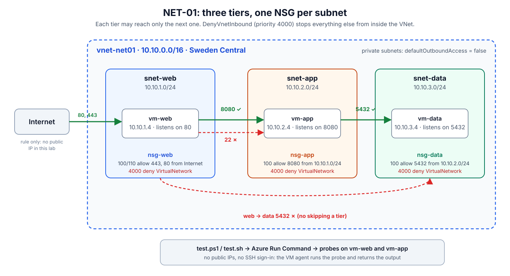

# NET-01: VNet, subnets and NSGs: the first network

Article: <https://cloudtales.gr/recipes/networking/net-01-vnet-subnets-nsgs-first-network/>

What this deploys: a VNet with three private subnets (web, app, data), one NSG per subnet that lets each tier
reach only the next one, and one small Ubuntu VM per subnet to prove it. No public IPs; the tests use Run Command.



## Run it

```powershell
# PowerShell 7 + Az module (recipe GOV-02 installs both)
./deploy.ps1                      # Sweden Central, resource group rg-recipe-net-01, expires tomorrow
./test.ps1                        # five connections, OK / NO per line
./cleanup.ps1                     # deletes the resource group
```

```bash
# Bash + Azure CLI
./deploy.sh
./test.sh
./cleanup.sh
```

| | |
| --- | --- |
| Time | ~20 min |
| Lab cost | ~€0.30 an hour while the three D2als_v6 VMs run; clean up the same day |
| Tested | Nov 2026 |

Every resource sits in one resource group tagged `recipe=NET-01` and `expires=<date>`; `tools/Remove-ExpiredLabs.ps1` deletes what you forgot.
